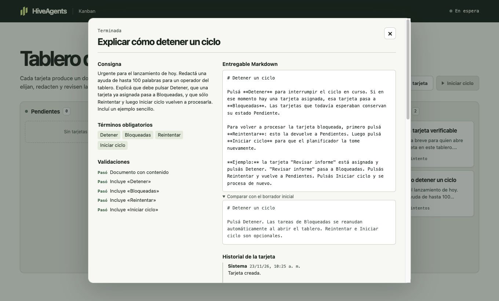

# Un Kanban de escritorio con HiveAgents Runtime

Construí un tablero en el que cada tarjeta encarga un documento Markdown. Vos definís el destinatario, la consigna y los criterios de aceptación. Si ya tenés un borrador, podés encargar su revisión. Al iniciar un ciclo, un agente lee la cola y elige qué atender primero, otro escribe el documento y un tercero decide si está listo para usar. Podés abrir la tarjeta y leer el resultado, las pruebas y el motivo de cada decisión.

**Si querés conocer todo el SDK**, el mapa de ejemplos muestra qué cubre la ventana, qué podés probar con procesos locales y cuáles son las pruebas que dependen de un proveedor. Incluye un consumidor ejecutable para cada una de las 11 entradas públicas de la beta. [Cobertura y laboratorios por funcionalidad](labs/README.md)

Los recorridos avanzados muestran el ciclo de aprendizaje con promoción y rollback, la ejecución entre un Host y un worker, y el manejo de aprobaciones nativas de Claude Code y Codex. [Tutoriales avanzados](labs/README.md#recorridos-avanzados)

Podés pedirle al SDK que elija sin indicar un modelo ni enumerar candidatos. El laboratorio muestra la selección inicial y cómo usar resultados verificados para decidir por tarea. [Selección automática de modelos](labs/auto-model.md)

La comparación de proveedores usa las mismas tareas de prioridad, redacción y revisión. Los resultados incluyen los controles y la latencia por turno. [Cómo medir y repetir la comparación](labs/benchmark.md)

## 1. Abrí el tablero

```sh
git clone https://github.com/hiveagents-dev/kanban-tutorial.git
cd kanban-tutorial
```

Este ejemplo es una app Electron con código disponible en este repositorio. Su única dependencia de aplicación es `hiveagents-runtime@0.1.0-beta.3` de npm. El ejemplo se probó en macOS con escritorio. Requiere Node.js 22.16 o superior. Para encargar nuevos turnos, autenticá Claude Code o Codex CLI. El gestor de paquetes descarga Electron al primer uso.

Para ver el resultado antes de configurar un proveedor, abrí la copia guardada desde la carpeta del tutorial.

```bash
npm ci
npm run demo:replay
```

Abrí **Explicar cómo detener un ciclo**, expandí **Comparar con el borrador inicial** y leé qué cambió después de la revisión. Estás viendo una copia de la corrida guardada. Podés recorrerla sin credenciales y con cero turnos de modelo.

Para encargar una tarjeta propia, cerrá esa ventana y ejecutá estos comandos desde la misma carpeta. El primero muestra una tabla de los cuatro proveedores. El segundo abre tu tablero de trabajo. El primer turno se consume al pulsar **Iniciar ciclo**.

```bash
node labs/providers.mjs
npm start
```

## 2. Dale una decisión real al planificador

La primera vez vas a ver **Preparar una tarjeta verificable** en Pendientes. Pulsá **Nueva tarjeta** e ingresá esta segunda tarea.

| Campo | Qué escribir |
| --- | --- |
| Título | Explicar cómo detener un ciclo |
| Consigna | Urgente para el lanzamiento de hoy. Redactá una ayuda breve para una persona que opera este tablero. Explicá cómo detener un ciclo, dónde aparece una tarjeta ya asignada y cómo volver a procesarla. Incluí un ejemplo. |
| Términos obligatorios | Escribí `Detener`, `Bloqueadas`, `Reintentar` e `Iniciar ciclo`, uno por línea. |

En **Borrador inicial**, probá pegar esta indicación que contiene los cuatro términos pero describe mal la recuperación.

> Pulsá Detener. Las tareas de Bloqueadas se reanudan automáticamente al abrir el tablero. Reintentar e Iniciar ciclo son opcionales.

Pulsá **Iniciar ciclo** una sola vez. Observá qué tarjeta pasa primero a **En curso**. Abrila y leé la justificación del planificador. Cuando llegue a **Terminadas**, vas a encontrar el documento que superó las comprobaciones junto con el dictamen del revisor. En la tarjeta sobre detenciones, compará el borrador original con la corrección y buscá qué observó el revisor aunque los cuatro términos estaban presentes. Cada turno completado indica su modelo seleccionado y duración y permite consultar su identificador de recibo.

Para repetir el recorrido desde la ventana con datos temporales, ejecutá `npm run demo:live`. Consume turnos reales de tu cuenta. Procesa la tarjeta inicial y otra con un borrador incorrecto, verifica los entregables y los recibos contra el SDK y guarda dos capturas y un `verified-run.json` en el directorio que imprime. Si el comando se interrumpe, volvé a abrir ese mismo tablero con `KANBAN_DATA_DIR=/ruta/impresa npm start`. La tarjeta conserva su último estado. Leé la devolución y decidí si corresponde reintentar.

### Qué ocurrió en la corrida guardada

El 23 de noviembre de 2026 abrimos Electron en macOS con la beta de npm. El planificador eligió primero la segunda tarjeta por su urgencia. El borrador sobre detenciones contenía los cuatro términos pedidos y pasó los cinco controles locales, incluido el de contenido. El revisor detectó la afirmación falsa sobre la reanudación automática. El redactor la corrigió y un nuevo revisor aprobó el texto en el segundo intento.

La guía **Preparar una tarjeta verificable** agotó sus dos intentos y quedó bloqueada. Leímos la devolución y pulsamos **Reintentar** e **Iniciar ciclo**. El tablero conservó la evidencia del primer ciclo y la guía terminó aprobada. En total quedaron 12 turnos completados con Claude Sonnet 5. Tu ejecución puede tomar otras decisiones. [Registro con los documentos, recibos y huellas SHA-256](evidence/verified-run.json) · [Vista final del tablero](evidence/tablero.png)

Repetimos el recorrido con `KANBAN_MODEL=codex/gpt-5.6-sol`. Codex también rechazó y corrigió la indicación falsa. En la otra tarjeta, un turno de redacción se interrumpió. El tablero la bloqueó, conservó la tarjeta ya terminada y completó la guía al reintentarla desde la ventana. [Registro de la ejecución con Codex](evidence/codex-run.json)



## 3. Conectá la vista a una cola local

El renderer envía operaciones concretas a través de `window.kanban`. El proceso principal valida el origen de cada llamada, mantiene una única instancia del tablero para ese directorio y conserva la autoridad para cambiar estados. La ventana dibuja el Markdown como texto. Un documento generado puede contener HTML y se seguirá mostrando como parte del entregable. [Ventana y límites de IPC](src/main.mjs) · [Puente de la vista](src/preload.cjs) · [Guía de seguridad de Electron](https://www.electronjs.org/docs/latest/tutorial/security)

La composición del tablero tiene tres piezas. Podés reutilizar la cola desde Node o probarla inyectando otras implementaciones.

```js
const board = createBoard({
  store: openStore(data),
  agents: createAgents({ cwd, receiptDirectory }),
  onChange: () => notifyWindow(),
});

board.create({ title, brief, requiredTerms });
await board.run();
```

En este fragmento, `notifyWindow` representa una notificación a la vista. En Electron el proceso principal envía ese evento sin datos. La vista pide un snapshot después de recibirla. El planificador sólo recibe las tarjetas elegibles del lote inicial y debe devolver uno de esos identificadores. La aplicación guarda la asignación antes de enviar el encargo al redactor. [Cola y transiciones](src/board.mjs) · [Persistencia local](src/store.mjs)

## 4. Ejecutá los roles y verificá el trabajo

| Responsable | Qué recibe | Qué entrega |
| --- | --- | --- |
| Planificador | Identificador, título, consigna y términos de las tarjetas pendientes | Identificador elegido y motivo |
| Redactor | Consigna y términos. En una corrección, también el borrador anterior y las observaciones | Documento Markdown completo |
| Pruebas locales | Documento exacto y términos de la tarjeta | Un resultado por control. Verifican contenido y coincidencias literales con normalización Unicode, sin distinguir mayúsculas |
| Revisor | Consigna, documento y resultados de las pruebas | Aprobación u observaciones concretas sobre qué falta para que el documento le sirva a su destinatario |

Cada rol abre un agente independiente. `createAgent` del módulo de routing comprueba el candidato y registra un recibo antes de devolver el agente. La llamada que **ejecuta** el CLI es `agent.run`. Todos los roles piden salida estructurada y comparten la señal de detención del ciclo.

```js
const result = await agent.run(JSON.stringify(data), {
  outputSchema, signal, timeoutMs: remaining(), awaitSettlement: true,
});
```

Si la tarjeta ya incluye un borrador, ese texto ocupa el primer intento y pasa directo a pruebas y revisión. Si falla un término literal, el tablero devuelve ese control al redactor. Si pasan los controles pero el revisor encuentra una omisión, devuelve su observación al redactor. Una tarjeta termina cuando el mismo borrador pasa ambos controles. El límite es de dos borradores por tarjeta y ciclo. Si ambos fallan, queda **Bloqueada** con su último documento y los motivos. **Reintentar** la devuelve a Pendientes y **Iniciar ciclo** habilita otro presupuesto de trabajo. [Implementación de los roles](src/agents.mjs) · [Regresiones de revisión y recuperación](tests/board.test.mjs)

### Qué CLI usa la app

El SDK incluye Claude Code, Codex, Gemini CLI y Antigravity CLI. Para este tutorial elegimos dos perfiles compatibles con el contrato de salida estructurada y los permisos del tablero. La app intenta primero Claude Sonnet con contexto limpio y cero herramientas. Si la selección previa declara que no hay ruta, prueba Codex en un directorio dedicado con sandbox de solo lectura y sesión efímera. Si una ejecución ya empezó, un error detiene el ciclo para que puedas inspeccionarlo. Cada perfil admite explícitamente candidatos de catálogo sin verificación individual y exige autenticación conocida. Un recibo registra la selección del modelo. El retorno validado, los controles y la revisión quedan en la tarjeta.

En esta beta el adaptador de Gemini CLI no admite el esquema nativo de salida usado por estos roles, y el de Antigravity requiere permiso de edición. Podés elegir Codex para todo el recorrido con este comando.

```bash
KANBAN_MODEL=codex/gpt-5.6-sol npm start
```

## 5. Probá fallos y reinicios

```bash
npm test
npm run test:desktop
```

La primera suite simula respuestas de los CLIs para reproducir una redacción incompleta, un veto del revisor, cancelaciones tardías, errores de persistencia y recuperación. La segunda abre Electron, crea una tarjeta desde el formulario, cierra la ventana y comprueba que sigue ahí al reabrirla. También reproduce la recuperación tras un fallo de escritura y el recorrido de iniciar, detener al redactor y reintentar desde la ventana. Para este último caso se simula la respuesta del modelo. Estos dos comandos consumen cero turnos.

En uso normal, **Detener** cancela el ciclo. Si ya había una tarjeta asignada, pasa a Bloqueadas y conserva la última evidencia guardada. Las pendientes siguen disponibles para el próximo ciclo. Después de un cierre inesperado, la aplicación marca como bloqueadas las tarjetas que estaban en curso o en revisión. Si el disco vuelve a estar disponible y la única tarjeta quedó en curso con el ciclo detenido, pulsá **Recuperar tablero**. Abrir la ventana nunca lanza trabajo automáticamente.

Cada ciclo toma hasta ocho tarjetas pendientes. Una tarjeta escrita y aprobada al primer intento consume tres turnos. Un borrador inicial aprobado sin cambios consume dos. Una que necesita dos revisiones puede consumir cinco. El máximo por ciclo es de cuarenta turnos, con un plazo de 120 segundos por turno y espera al cierre del proceso del proveedor.

### Datos y alcance

La app guarda `board.json` y la carpeta `receipts/` en su directorio de datos de Electron. Podés elegir una carpeta propia con `KANBAN_DATA_DIR=/ruta/absoluta npm start`. Los prompts incluyen el contenido necesario de la tarjeta y se procesan bajo la cuenta del CLI elegido. El tablero se diseñó para una persona y una instancia local. La comprobación de términos es mecánica y el juicio editorial del revisor es falible. Para aplicar el patrón a otro entregable, reemplazá el esquema del redactor y los controles por pruebas específicas de ese dominio.

[Paquete instalado por la app](https://www.npmjs.com/package/hiveagents-runtime/v/0.1.0-beta.3)
