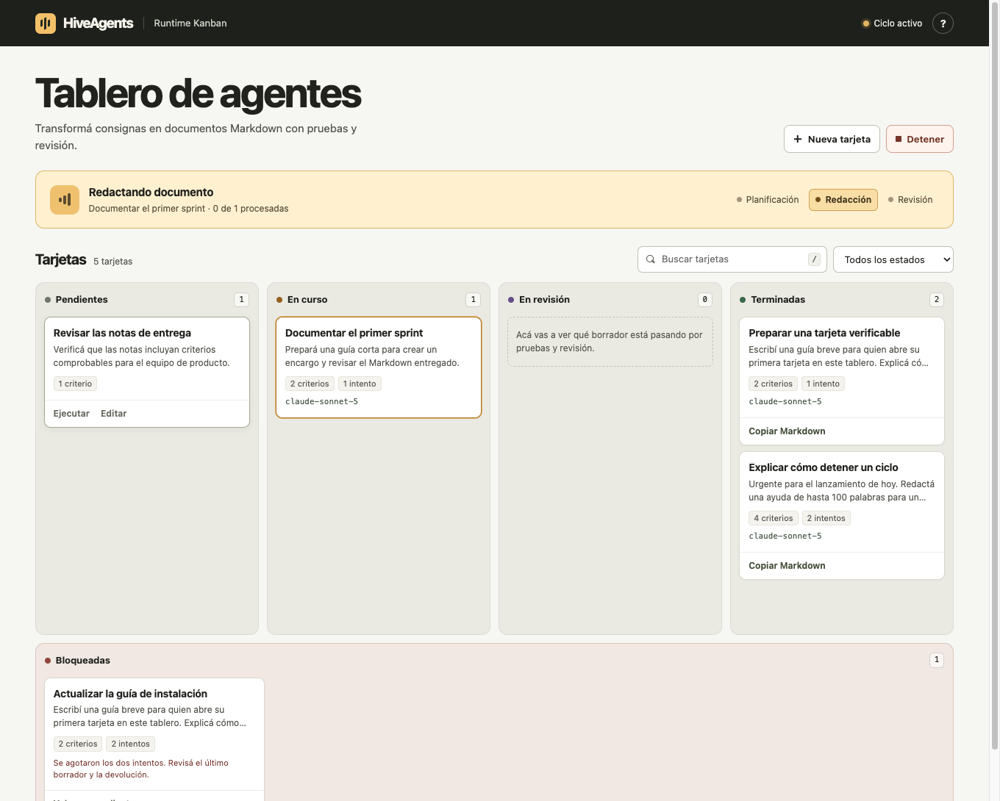

# Kanban de agentes con HiveAgents Runtime

Encargá un documento Markdown desde un tablero de escritorio. Dale al planificador una cola de tareas, mirá qué elige y seguí cómo el redactor y el revisor convierten la consigna en un entregable verificable. Cada tarjeta conserva el borrador, las comprobaciones y las decisiones que explican el resultado.



[Abrí el tablero](#1-abrí-el-tablero) · [Operación y acciones](#operá-el-tablero) · [Asistente y memoria](docs/assistant.md) · [Routing y aprendizaje](docs/model-routing.md) · [Diagramas del tablero](docs/architecture.md) · [Arquitectura del SDK](docs/runtime-architecture.md) · [Laboratorios de las 11 entradas del SDK](labs/README.md) · [Descargas](https://github.com/hiveagents-dev/kanban-tutorial/releases)

El tablero pide al SDK que elija desde el catálogo de cada proveedor compatible. Podés aplicar una política aprobada al redactor y evaluar nuevas políticas con un corpus reproducible y un verificador independiente. [Selección y aprendizaje en el tablero](docs/model-routing.md) · [Comparación medida](labs/benchmark.md) · [Laboratorios avanzados](labs/README.md#recorridos-avanzados)

## 1. Abrí el tablero

```sh
git clone https://github.com/hiveagents-dev/kanban-tutorial.git
cd kanban-tutorial
```

Necesitás Node.js 22.16 o posterior y una sesión gráfica de macOS, que es el entorno verificado. `npm ci` instala Electron y el SDK publicado `hiveagents-runtime@0.1.0-beta.3`. Para encargar nuevos turnos, instalá y autenticá Claude Code o Codex CLI.

Para ver el resultado antes de configurar un proveedor, abrí la copia guardada desde la carpeta del tutorial.

```bash
npm ci
npm run demo:replay
```

Abrí **Explicar cómo detener un ciclo**, expandí **Comparar con el borrador inicial** y leé qué cambió después de la revisión. La vista abre una copia temporal de la corrida guardada. Podés recorrerla sin credenciales y con cero turnos de modelo.

Para encargar una tarjeta propia, cerrá esa ventana y ejecutá estos comandos desde la misma carpeta. El primero muestra una tabla de los cuatro proveedores. El segundo abre tu tablero de trabajo. Consumís el primer turno al pulsar **Iniciar ciclo** o **Ejecutar tarjeta**.

```bash
node labs/providers.mjs
npm start
```

## Operá el tablero

| Acción | Qué hace |
| --- | --- |
| **Nueva tarjeta** | Crea una consigna con términos comprobables y, opcionalmente, un borrador para revisar. |
| **Buscar** y filtrar | Encontrá tarjetas por título, consigna o términos, y acotá por estado. Limpiá el filtro para volver a la cola completa. |
| **Editar** | Cambiá una tarjeta pendiente antes de que se asigne por primera vez. La edición está disponible entre ciclos. |
| **Duplicar** | Abre una tarjeta nueva con el encargo y el borrador inicial. La historia de la original queda asociada a sus criterios. |
| **Iniciar ciclo** | El planificador prioriza hasta ocho pendientes. Las tarjetas creadas después esperan el siguiente ciclo. |
| **Ejecutar tarjeta** | Procesa sólo la pendiente que elegiste, con los mismos controles que en un ciclo de varias tarjetas. |
| **Detener** y **Reintentar** | Detené el ciclo activo. Inspeccioná la tarjeta bloqueada y devolvela a Pendientes cuando esté lista. |
| **Copiar Markdown** y copiar recibo | Llevá el último documento al portapapeles o copiá un ID para buscar su recibo en la carpeta de datos. |

La barra del ciclo muestra si el tablero está planificando, redactando, revisando o deteniéndose. En el detalle podés leer juntos el motivo del planificador, el borrador, los controles, el dictamen y la evidencia de cada turno. La duración corresponde al turno informado por la app y el recibo identifica la selección del modelo. [Vista del entregable y su evidencia](evidence/kanban-evidence.png)

## Probá el asistente y la memoria

El asistente del tablero señala tarjetas trabadas, explica su historial y propone acciones desde el chat. Al crear una tarjeta, el formulario busca trabajos parecidos que ya estén en curso o terminados.

```sh
npm run demo:assistant
```

Abrí la alerta de **A2**, respondela y revisá la acción propuesta. La alerta y las coincidencias funcionan sin credenciales. Enviar el mensaje y ejecutar la propuesta usan tu CLI autenticado. [Recorrido y diagramas del asistente](docs/assistant.md)

## 2. Dale una decisión real al planificador

La primera vez vas a ver **Preparar una tarjeta verificable** en Pendientes. Pulsá **Nueva tarjeta** e ingresá esta segunda tarea.

| Campo | Qué escribir |
| --- | --- |
| Título | Explicar cómo detener un ciclo |
| Consigna | Urgente para el lanzamiento de hoy. Redactá una ayuda breve para una persona que opera este tablero. Explicá cómo detener un ciclo, dónde aparece una tarjeta ya asignada y cómo volver a procesarla. Incluí un ejemplo. |
| Términos obligatorios | Escribí `Detener`, `Bloqueadas`, `Reintentar` e `Iniciar ciclo`, uno por línea. |

En **Borrador inicial**, probá pegar esta indicación que contiene los cuatro términos pero describe mal la recuperación.

> Pulsá Detener. Las tareas de Bloqueadas se reanudan automáticamente al abrir el tablero. Reintentar e Iniciar ciclo son opcionales.

Pulsá **Iniciar ciclo** una sola vez. Observá qué tarjeta pasa primero a **En curso**. Abrila y leé la justificación del planificador. Cuando llegue a **Terminadas**, vas a encontrar el documento que superó las comprobaciones junto con el dictamen del revisor. En la tarjeta sobre detenciones, compará el borrador original con la corrección y buscá qué observó el revisor aunque los cuatro términos estaban presentes. Luego duplicá una tarjeta y usá **Ejecutar tarjeta** para probar una consigna similar sin procesar las otras pendientes. Cada turno completado indica su modelo seleccionado y duración y permite consultar su identificador de recibo.

Para repetir el recorrido desde la ventana con datos temporales, ejecutá `npm run demo:live`. Consume turnos reales de tu cuenta. Procesa la tarjeta inicial y otra con un borrador incorrecto, verifica los entregables y los recibos contra el SDK y guarda dos capturas y un `verified-run.json` en el directorio que imprime. Si el comando se interrumpe, volvé a abrir ese mismo tablero con `KANBAN_DATA_DIR=/ruta/impresa npm start`. La tarjeta conserva su último estado guardado. Leé la devolución y decidí si corresponde reintentar.

### Qué ocurrió en la corrida guardada

El 23 de noviembre de 2026 abrimos Electron en macOS con la beta de npm. El planificador eligió primero la segunda tarjeta por su urgencia. El borrador sobre detenciones contenía los cuatro términos pedidos y pasó los cinco controles locales, incluido el de contenido. El revisor detectó la afirmación falsa sobre la reanudación automática. El redactor la corrigió y un nuevo revisor aprobó el texto en el segundo intento.

La guía **Preparar una tarjeta verificable** agotó sus dos intentos y quedó bloqueada. Leímos la devolución y pulsamos **Reintentar** e **Iniciar ciclo**. El tablero conservó la evidencia del primer ciclo y la guía terminó aprobada. En total quedaron 12 turnos completados con Claude Sonnet 5. Tu ejecución puede tomar otras decisiones. [Registro con los documentos, recibos y huellas SHA-256](evidence/verified-run.json) · [Vista final del tablero](evidence/tablero.png)

Repetimos el recorrido con `KANBAN_MODEL=codex/gpt-5.6-sol`. Codex también rechazó y corrigió la indicación falsa. En la otra tarjeta, un turno de redacción se interrumpió. El tablero la bloqueó, conservó la tarjeta ya terminada y completó la guía al reintentarla desde la ventana. [Registro de la ejecución con Codex](evidence/codex-run.json)

[Captura histórica de la revisión](evidence/revision.png)

## 3. Conectá la vista a una cola local

Los diagramas muestran los procesos y límites, la secuencia de cada rol y las transiciones al revisar, detener y recuperar. [Arquitectura del Kanban](docs/architecture.md)

El renderer envía operaciones concretas a través de `window.kanban`. El proceso principal valida el origen de cada llamada, mantiene una única instancia del tablero para ese directorio y conserva la autoridad para cambiar estados. La ventana dibuja el Markdown como texto. Un documento generado puede contener HTML y se seguirá mostrando como parte del entregable. [Ventana y límites de IPC](src/main.mjs) · [Puente de la vista](src/preload.cjs) · [Guía de seguridad de Electron](https://www.electronjs.org/docs/latest/tutorial/security)

La composición del tablero tiene tres piezas. Podés reutilizar la cola desde Node o probarla inyectando otras implementaciones.

```js
const board = createBoard({
  store: openStore(data),
  agents: createAgents({ cwd, receiptDirectory }),
  onChange: () => notifyWindow(),
});

board.create({ title, brief, requiredTerms });
await board.run();
```

En este fragmento, `notifyWindow` representa una notificación a la vista. En Electron el proceso principal envía ese evento sin datos. La vista pide un snapshot después de recibirla. El planificador sólo recibe las tarjetas elegibles del lote inicial y debe devolver uno de esos identificadores. La aplicación guarda la asignación antes de enviar el encargo al redactor. [Cola y transiciones](src/board.mjs) · [Persistencia local](src/store.mjs)

## 4. Ejecutá los roles y verificá el trabajo

| Responsable | Qué recibe | Qué entrega |
| --- | --- | --- |
| Planificador | Identificador, título, consigna y términos de las tarjetas pendientes | Identificador elegido y motivo |
| Redactor | Consigna y términos. En una corrección, también el borrador anterior y las observaciones | Documento Markdown completo |
| Pruebas locales | Documento exacto y términos de la tarjeta | Un resultado por control. Verifican contenido y coincidencias literales con normalización Unicode, sin distinguir mayúsculas |
| Revisor | Consigna, documento y resultados de las pruebas | Aprobación u observaciones concretas sobre qué falta para que el documento le sirva a su destinatario |

Cada rol abre un agente independiente. `createAgent` del módulo de routing comprueba el candidato y registra un recibo antes de devolver el agente. La llamada que **ejecuta** el CLI es `agent.run`. Los roles usan el esquema nativo de su proveedor y comparten la señal de detención del ciclo. El modo optativo de aprendizaje del redactor usa JSON validado por la aplicación.

```js
const result = await agent.run(JSON.stringify(data), {
  outputSchema, signal, timeoutMs: remaining(), awaitSettlement: true,
});
```

Si la tarjeta ya incluye un borrador, ese texto ocupa el primer intento y pasa directo a pruebas y revisión. Si falla un término literal, el tablero devuelve ese control al redactor. Si pasan los controles pero el revisor encuentra una omisión, devuelve su observación al redactor. Una tarjeta termina cuando el mismo borrador pasa ambos controles. El límite es de dos borradores por tarjeta y ciclo. Si ambos fallan, queda **Bloqueada** con su último documento y los motivos. **Reintentar** la devuelve a Pendientes y **Iniciar ciclo** habilita otro presupuesto de trabajo. [Implementación de los roles](src/agents.mjs) · [Regresiones de revisión y recuperación](tests/board.test.mjs)

### Qué CLI usa la app

El SDK incluye Claude Code, Codex, Gemini CLI y Antigravity CLI. La app usa dos perfiles compatibles con su esquema de salida y permisos. Primero consulta el catálogo de Claude Code con contexto limpio y sin herramientas. Si el SDK se queda sin ruta antes de ejecutar, consulta el de Codex con sandbox de sólo lectura y sesión efímera. Cada perfil exige autenticación conocida y permite comprobar candidatos cuyo catálogo todavía figura como no verificado. El mismo modelo puede atender varios roles. [Cómo se selecciona el modelo y se mide su desempeño](docs/model-routing.md)

En esta beta el adaptador de Gemini CLI no admite el esquema nativo de salida usado por estos roles, y el de Antigravity requiere permiso de edición. Podés elegir Codex para todo el recorrido con este comando.

```bash
KANBAN_MODEL=codex/gpt-5.6-sol npm start
```

## 5. Probá fallos y reinicios

```bash
npm test
npm run test:desktop
```

La primera suite prueba la cola, los roles y los laboratorios con respuestas deterministas. La segunda abre Electron y comprueba acciones, evidencia, persistencia, recuperación y detención desde la interfaz. Ambas consumen cero turnos comerciales.

En uso normal, **Detener** cancela el ciclo. Si ya había una tarjeta asignada, pasa a Bloqueadas y conserva la última evidencia guardada. Las pendientes siguen disponibles para el próximo ciclo. Después de un cierre inesperado, la aplicación marca como bloqueadas las tarjetas que estaban en curso o en revisión. Si falla el guardado y queda una tarjeta en curso con el ciclo detenido, liberá espacio o restaurá el acceso a la carpeta. Con otras pendientes, **Iniciar ciclo** recupera primero el estado. Si la cola está vacía, pulsá **Recuperar tablero**. Abrir la ventana nunca lanza trabajo automáticamente.

Cada ciclo toma hasta ocho tarjetas pendientes. Una tarjeta escrita y aprobada al primer intento consume tres turnos. Un borrador inicial aprobado sin cambios consume dos. Una que necesita dos revisiones puede consumir cinco. El máximo por ciclo es de cuarenta turnos, con un plazo de 120 segundos por turno y espera al cierre del proceso del proveedor.

### Datos y alcance

La app guarda `board.json` y la carpeta `receipts/` en su directorio de datos de Electron. Podés elegir una carpeta propia con `KANBAN_DATA_DIR=/ruta/absoluta npm start`. Los prompts incluyen el contenido necesario de la tarjeta y se procesan bajo la cuenta del CLI elegido. El tablero se diseñó para una persona y una instancia local. La comprobación de términos es mecánica y el juicio editorial del revisor es falible. Para aplicar el patrón a otro entregable, reemplazá el esquema del redactor y los controles por pruebas específicas de ese dominio.

[Paquete instalado por la app](https://www.npmjs.com/package/hiveagents-runtime/v/0.1.0-beta.3)
