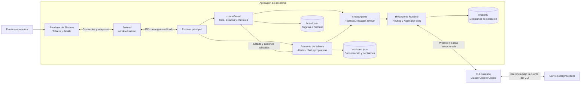
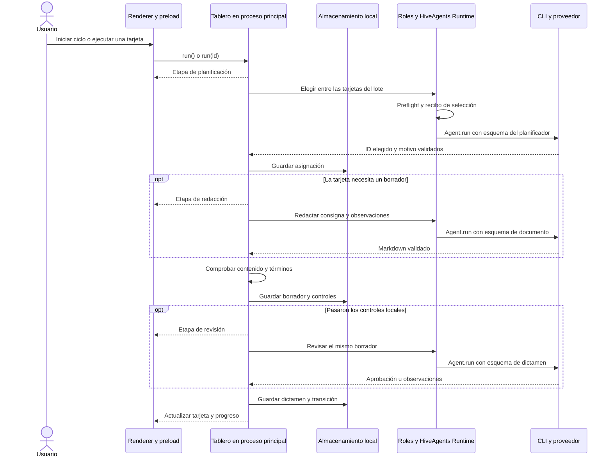
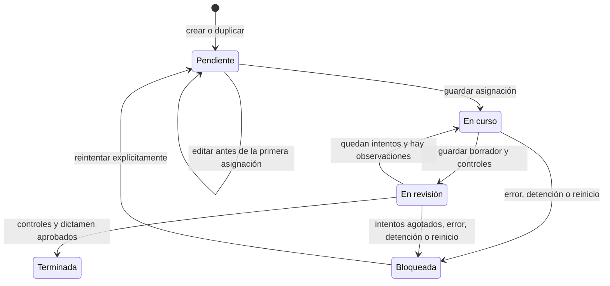

# Arquitectura del Kanban de HiveAgents

El tablero convierte una consigna en un documento Markdown verificable. Electron presenta la cola y la evidencia. La aplicación controla el orden, el estado y los criterios. HiveAgents Runtime selecciona y ejecuta el CLI que atiende cada rol. El proveedor procesa el contenido bajo la cuenta configurada en su CLI.

## Procesos y límites

| Pieza | Dónde cambiarla | Qué controla |
| --- | --- | --- |
| Ventana | [ui](../ui) | Muestra el estado guardado y la etapa en curso. Pide acciones concretas por el puente. |
| IPC | [main.mjs](../src/main.mjs) y [preload.cjs](../src/preload.cjs) | Valida ventana, frame y URL. Abre el único tablero local y expone comandos explícitos. |
| Dominio | [board.mjs](../src/board.mjs) | Valida tarjetas, acota lote e intentos, comprueba requisitos y decide transiciones. |
| Roles y SDK | [agents.mjs](../src/agents.mjs) | Construye prompts y esquemas, configura permisos por proveedor, selecciona antes de ejecutar y comparte la señal de detención. |
| Almacenamiento | [store.mjs](../src/store.mjs) | Abre el formato versionado y guarda cada cambio mediante un archivo temporal y reemplazo. |

El renderer corre con sandbox e aislamiento de contexto. Dibuja el documento y las devoluciones como texto. La copia la realiza el proceso principal leyendo el entregable o el ID de recibo de la tarjeta. Los CLIs trabajan desde `agent-workspace/`, separado de `board.json` y `receipts/`. Los permisos y las garantías del CLI dependen del perfil negociado. [Perfiles por proveedor y alcance](../README.md#qué-cli-usa-la-app)

## Qué pasa al iniciar un ciclo

Cada rol usa un agente independiente. La selección se hace desde el catálogo de cada perfil y el mismo modelo puede cumplir varios roles. El redactor puede consultar una política aprobada. El comando de medición registra resultados de un corpus sintético por separado. El planificador elige dentro del lote fijado al inicio, de hasta ocho tarjetas. En la ejecución individual el lote contiene una tarjeta. La app admite dos borradores por tarjeta y ciclo. Si hay un borrador inicial, éste ocupa el primer intento. Los controles locales devuelven fallos literales al redactor. El revisor evalúa si el documento cumple la consigna. Sólo se completa la tarjeta cuando el mismo borrador supera ambos controles. [Selección y aprendizaje del tablero](model-routing.md)

La vista muestra la fase del ciclo y pide un snapshot cada vez que el proceso principal informa un cambio. La tarjeta guarda las decisiones y los turnos terminados con modelo, duración e ID de recibo. El recibo explica la selección previa. Los controles y el dictamen permiten evaluar el documento que se entregó. [Flujo de ejecución](../src/board.mjs) · [Contratos de cada rol](../src/agents.mjs)

## Estados y recuperación

- **Detener.** El tablero aborta la señal compartida. Si ya asignó una tarjeta, la bloquea y conserva la evidencia escrita. Las demás tarjetas del lote quedan disponibles. Los resultados que llegan después de la detención se descartan.
- **Reabrir.** Una tarjeta guardada en curso o revisión queda bloqueada para que puedas inspeccionarla. Si un fallo de escritura impidió guardar la transición durante la sesión, **Recuperar tablero** vuelve a intentar ese cambio local. Abrir la app deja cualquier ejecución a tu cargo.
- **Cambiar el encargo.** La edición está disponible para tarjetas pendientes sin asignaciones previas. Para cambiar criterios después de una asignación, duplicá la tarjeta. Así podés contrastar el encargo original con sus pruebas y dictámenes.
- **Reintentar.** Devuelve la tarjeta a Pendientes y reinicia el contador de intentos del próximo ciclo. La historia y el último borrador se conservan. Iniciá otro ciclo o ejecutá esa tarjeta.

Los datos viven en el directorio `userData` de Electron o en el directorio absoluto elegido con `KANBAN_DATA_DIR`. Éste es un tablero local de una persona. Si necesitás dependencias entre trabajos, verificación de efectos externos, cupos compartidos o un worker separado, los laboratorios muestran esas piezas del SDK por separado. [Laboratorios por capacidad](../labs/README.md)

## Del tablero a tu aplicación

El asistente lee la cola completa, presenta alertas locales y valida las propuestas del chat antes de enviarlas a la cola. La memoria por columna recupera antecedentes de la misma historia del tablero. [Arquitectura del asistente y la memoria](assistant.md)

| Si tu aplicación necesita… | Usá este recorrido |
| --- | --- |
| Descubrir modelos en todos los proveedores registrados | [Selección automática desde el catálogo](../labs/auto-model.md). El tablero usa dos perfiles elegidos por su compatibilidad con esquema y permisos. |
| Medir si conviene cambiar de modelo según la tarea | [Evaluación, promoción y reversión](../labs/learning-cycle.md). El laboratorio deriva candidatos del catálogo y compara resultados verificados. |
| Ejecutar un plan con dependencias y recuperar lo terminado | [Plan dinámico y journal](../labs/plan.mjs). La app puede reemplazar su cola local por el mecanismo adecuado a su dominio. |
| Revisar una solicitud de herramienta del proveedor | [Aprobaciones nativas de Control](../labs/native-approval.md). La ventana usa `exec` para sus roles. |
| Separar un proceso que pide trabajo de otro que controla admisión | [Host y worker](../labs/hosted-process.md). |

Para adaptar el ejemplo, cambiá el esquema del entregable, las comprobaciones locales y los criterios del revisor. Probá primero el contrato con respuestas deterministas y después con el proveedor que vas a usar. [Pruebas del tablero](../tests/board.test.mjs) · [Pruebas desde Electron](../tests/desktop.e2e.mjs) · [Evidencia de una corrida real](../evidence/verified-run.json)
