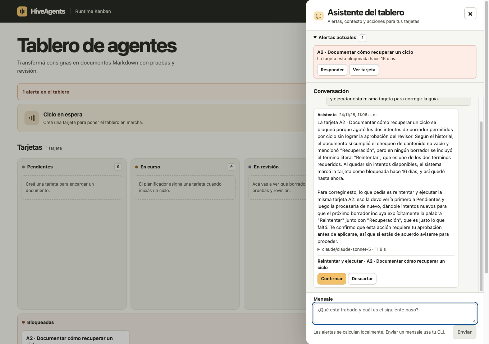
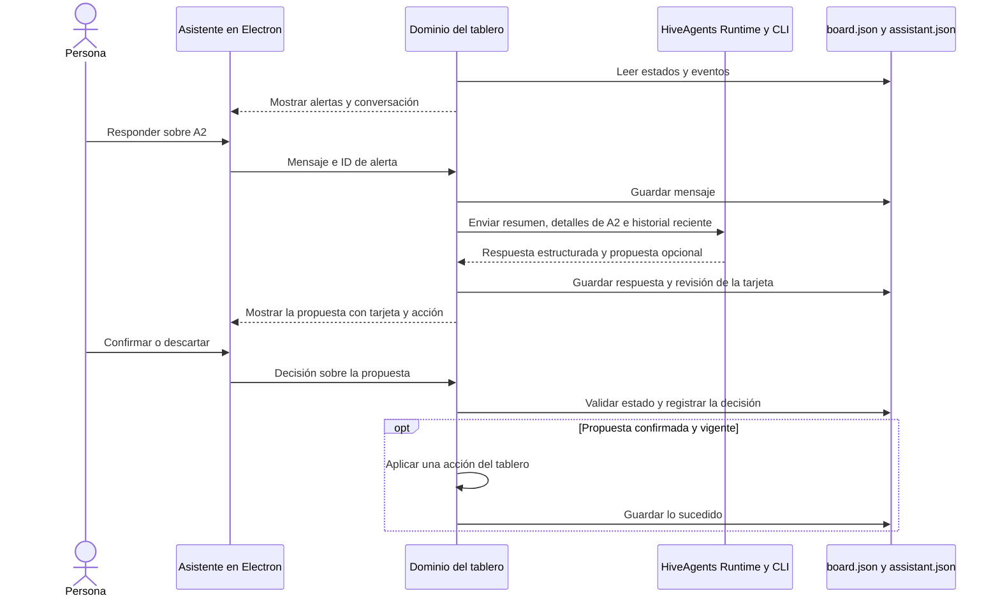
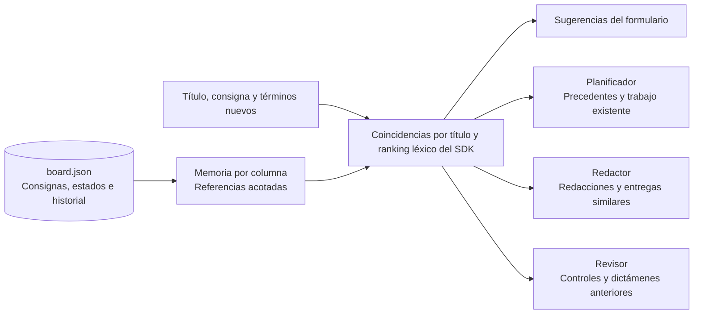

# Asistente del tablero y memoria por columna

El asistente reúne las alertas de todo el tablero en una sola conversación. Puede explicar por qué quedó bloqueada una tarjeta y proponer una forma de recuperarla. En el formulario, la memoria de la cola te muestra trabajos parecidos para que puedas volver a abrir el encargo o aprovechar una entrega anterior.

## Probá la alerta de A2

Desde la carpeta del tutorial corré estos comandos.

```sh
npm ci
npm run demo:assistant
```

1. Abrí **Asistente**. Vas a encontrar una tarjeta de ejemplo, **A2 · Documentar cómo recuperar un ciclo**, bloqueada hace 16 días. **Ver tarjeta** te lleva a su borrador y a los chequeos que fallaron.
2. Pulsá **Responder** en la alerta y escribí «¿Por qué quedó trabada A2? Reintentala y ejecutala para corregir el documento». Esto usa un turno del CLI autenticado. Con las mismas palabras, el modelo puede explicar el problema o proponer **Reintentar y ejecutar**.
3. Revisá el título de la tarjeta y confirmá la propuesta. El tablero recupera esa tarjeta y corre la misma secuencia de planificación, redacción y revisión que una ejecución individual. Mirá el resultado en el historial de la tarjeta. Si otro cambio volvió obsoleta la propuesta, pedí una nueva.
4. Creá otra tarjeta y escribí **Documentar cómo recuperar un ciclo** o el título exacto de A2. El formulario ofrece hasta tres coincidencias e indica su estado y el motivo. Podés abrir la anterior o seguir con la nueva.

La demo abre un directorio temporal, combina dos entregas de una corrida guardada con la tarjeta sintética A2 y lo imprime en la terminal. La alerta y las coincidencias funcionan sin iniciar sesión. Para probar el chat o ejecutar A2, autenticá Claude Code o Codex. Cada turno de chat se ejecuta al pulsar **Enviar**. Consultá los perfiles de proveedor y sus permisos antes de usar datos propios. [Abrir y configurar el tablero](../README.md#1-abrí-el-tablero)

En la verificación con Claude Sonnet 5, la alerta siguió visible hasta confirmar. La acción ejecutó los tres roles, A2 pasó a Terminada y el formulario recuperó esa entrega como coincidencia. [Registro de la corrida real](../evidence/assistant-live.json)



## Cómo decide el asistente



| Señal | Cuándo aparece | Qué podés hacer |
| --- | --- | --- |
| Tarjeta bloqueada | El tablero registró un error, agotó la revisión o se detuvo con trabajo asignado. A los 14 días sube de prioridad. | Abrir el historial, pedir una explicación o confirmar un reintento. |
| Pendiente antigua | La tarjeta lleva 14 días o más sin actividad. | Revisar la consigna o pedir ejecutar esa tarjeta. |
| Ejecución interrumpida | La tarjeta quedó en curso o revisión cuando ya no hay ciclo activo. | Usar la recuperación del tablero y revisar la evidencia antes de reintentar. |

El motor cuenta las tarjetas de toda la cola. Para cada consulta arma un resumen acotado, prioriza la alerta o las tarjetas mencionadas e incluye comprobaciones e historial de la tarjeta enfocada. La conversación reabre desde `assistant.json`. Cada turno puede recordar hasta ocho mensajes recientes del hilo correspondiente. La respuesta del modelo sigue siendo una sugerencia. El proceso principal verifica el ID, el estado y la revisión de la tarjeta antes de ejecutar una acción permitida. Si la app se cierra durante una confirmación, el próximo arranque conserva la conversación y pide revisar la tarjeta antes de repetir la acción. [Dominio del asistente y validación](../src/assistant.mjs) · [Puente de Electron](../src/preload.cjs)

## Cómo recuerdan las columnas



La memoria local se reconstruye a partir de `board.json`. Pendientes conserva decisiones del planificador; En curso, precedentes de redacción; En revisión, controles y observaciones. Las tarjetas Terminadas y Bloqueadas aportan referencias con su estado e historial. El formulario busca en toda la cola, incluidas las tarjetas ya terminadas. Los roles reciben referencias acotadas de las etapas que usan. En revisión, el dictamen sobre el documento actual sale de la consigna, los chequeos y el documento actual. [Alcance de memoria y ranking](../src/column-memory.mjs) · [Contratos y memoria de los roles](../src/agents.mjs)

El ranking es léxico. Normaliza el título y ordena coincidencias de palabras de la consigna y los términos con `rankMemories` del SDK. Puede pasar por alto sinónimos y tareas expresadas con otras palabras. Abrí la tarjeta sugerida para comprobar que el trabajo te sirve. Los archivos locales guardan la conversación y las tarjetas; lo que el chat o los roles reciben para resolver su turno se procesa bajo la cuenta del CLI elegido. [Procesos y límites del tablero](architecture.md)
