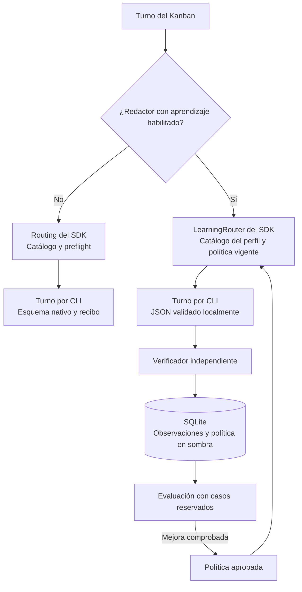

# Selección de modelos y aprendizaje en el Kanban

Al abrir el tablero sin indicar un modelo, cada rol pide selección automática a `hiveagents-runtime/routing`. El SDK lee el catálogo registrado, verifica la preparación del CLI y guarda un recibo antes de ejecutar. Con la política inicial, el primer candidato elegible gana por prioridad. El recibo permite consultar cuál eligió y por qué.

La app define dos perfiles. Prueba el catálogo de Claude Code con contexto limpio y sin herramientas. Si ese perfil se queda sin ruta en el preflight, prueba el de Codex con sandbox de sólo lectura. La beta comparte los permisos y opciones entre todos los candidatos de una selección. El orden entre esos dos perfiles es una decisión de la app. Dentro de cada perfil, el SDK toma los modelos del catálogo. [Catálogo y perfiles del tablero](../src/board-routing.mjs)



Podés fijar un modelo para comparar o reproducir un caso con `KANBAN_MODEL`. El SDK sigue verificando la disponibilidad y los permisos de ese modelo.

## Recolectá evidencia real del redactor

El aprendizaje del tablero es un modo optativo del redactor. Usa la misma instalación y los mismos permisos del perfil seleccionado. En esta beta, `LearningRouter.run` ejecuta texto. El modo experimental pide JSON y valida que la única propiedad sea `markdown`. El camino normal conserva el esquema de salida nativo. Así las observaciones pertenecen al contrato que realmente se ejecutó.

```sh
npm ci
state_dir=$(mktemp -d)
npm run routing:train -- --live --data-dir "$state_dir" --provider codex --max-turns 4
KANBAN_DATA_DIR="$state_dir" KANBAN_LEARNING_PROVIDER=codex npm start
```

El comando explícito usa la sesión del CLI indicado y un presupuesto máximo de turnos. Sin `--live` muestra candidatos y política con cero turnos. La medición toma dos candidatos del catálogo y compara los mismos casos. Trabaja con tarjetas sintéticas y comprobaciones independientes. Guarda la evidencia en `routing-learning/evidence.sqlite` del directorio indicado. Al abrir el tablero con el mismo directorio y proveedor, sus redacciones optativas guardan observaciones de ese mismo contrato. El planificador, el revisor y el asistente siguen usando la selección normal.

El router guarda calidad verificada, latencia y uso cuando están disponibles. La medición de calidad cubre los requisitos del caso. Los chequeos literales en una tarjeta propia miden si aparecen los términos, y el revisor del tablero todavía comprueba el documento antes de marcarlo como terminado. Una corrida corta genera observaciones y una política en sombra. Podés repetir el comando en el mismo directorio para agregar casos pendientes. El SDK considera la cantidad y similitud de casos y la calidad que pudo verificar.

## Resultado medido

El piloto ejecutó cuatro consignas de entrenamiento con dos modelos de Codex. GPT-5.6 Terra pasó tres y GPT-5.6 Sol pasó dos. Al evaluarlos sobre ocho consignas reservadas, cada modelo pasó cinco. El gate verificó las 16 ejecuciones de la matriz y conservó la política vigente con el motivo `INSUFFICIENT`. El informe contiene los recibos, los controles y la duración de cada turno. [Evidencia del piloto y del gate](../evidence/kanban-routing-learning.json)

## Evaluá antes de cambiar la política

Evaluá la política en sombra con casos reservados y un presupuesto explícito. El comando exige al menos ocho observaciones verificadas sobre tareas distintas por candidato antes de gastar turnos en la matriz. El corpus ofrece 36 casos. Repetí el entrenamiento en el mismo directorio hasta alcanzar ese piso. La decisión final también considera la similitud y la calidad de las observaciones.

```sh
npm run routing:train -- --live --evaluate --data-dir "$state_dir" --provider codex --max-turns 16
```

La primera evaluación toma dos casos de regresión y seis casos nuevos. Cada candidato ejecuta todos los casos. El SDK exige evidencia comparable y tareas reservadas antes de activar una política. Una evaluación completa compara la candidata con la política vigente, exige una mejora y busca regresiones. Para el rollback vuelve a pedir evidencia nueva. Un cambio de CLI, perfil, contrato o protocolo puede dejar sin aplicación una política anterior.

Podés recorrer promoción y rollback con dos modelos de prueba, sin CLIs comerciales.

```sh
node labs/learning-cycle.mjs
```

El laboratorio controlado demuestra el mecanismo. Para decir cuál modelo conviene en tus tareas, compará candidatos del mismo contrato, guardá el resultado del verificador y reservá casos nuevos para decidir el cambio. [Evaluación, promoción y rollback](../labs/learning-cycle.md) · [Método de comparación entre proveedores](../labs/benchmark.md)
