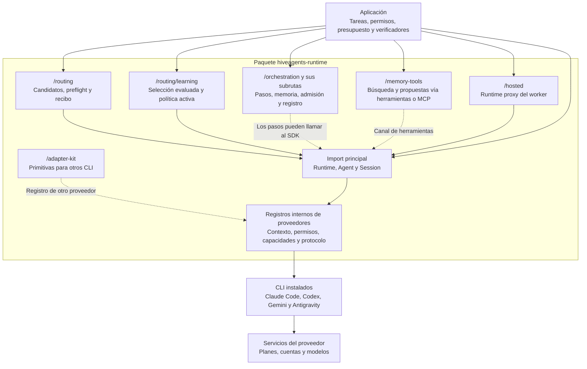
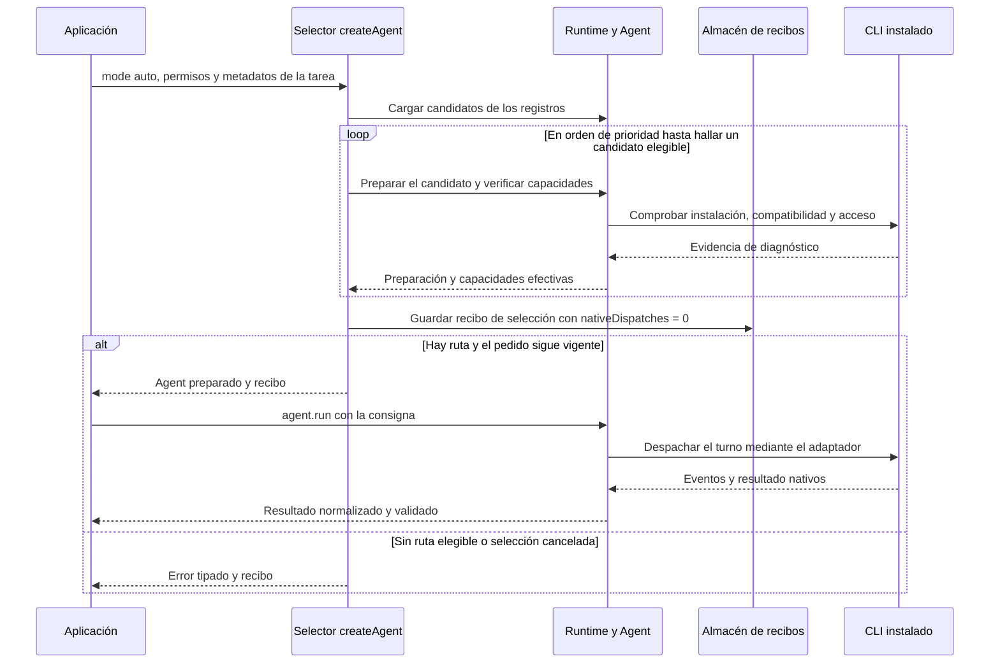
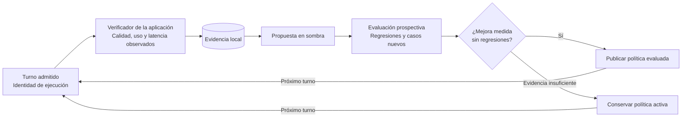
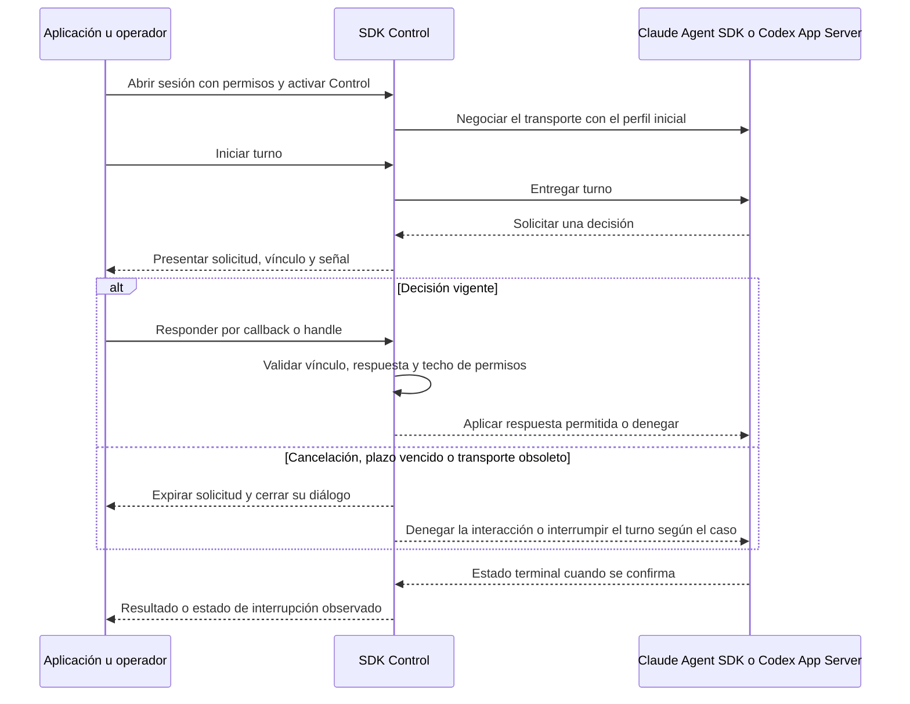
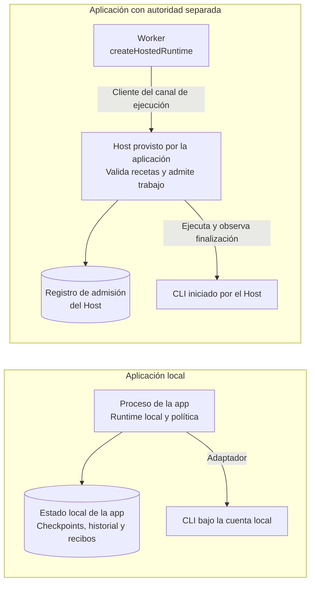

# Arquitectura de HiveAgents Runtime

HiveAgents Runtime es un SDK TypeScript para ejecutar los CLI de agentes que ya usás. Tu aplicación define el trabajo, los permisos y los criterios de aceptación. El SDK traduce ese contrato al proveedor, prepara el turno y normaliza su resultado. El CLI conserva su autenticación y ejecuta el trabajo según su configuración y las capacidades negociadas. [Inicio rápido](../README.md#1-abrí-el-tablero) · [Laboratorios por capacidad](../labs/README.md)

Los diagramas cubren las interfaces de la beta y señalan dónde cambia el comportamiento según el proveedor o despliegue. El laboratorio de escritorio instala `0.1.0-beta.3` desde npm. Para probar Antigravity CLI 1.5.15 usá el artefacto de `0.1.0-beta.4` indicado en sus notas. [Compatibilidad de los laboratorios](../labs/README.md#pruebas-en-vivo-y-comparación-de-proveedores) · [Antigravity y beta.4](../labs/antigravity-live.md)

## Un paquete, varios niveles de integración

`package.json#exports` define las once entradas del mismo paquete. Los adaptadores incluidos son detalles de implementación. Para integrar otro CLI, construí un `ProviderRegistration` que declare catálogo y capacidades y registre sus adaptadores. Para agregar estado a tu producto, componé la capa de orquestación alrededor de las llamadas al core. [Entradas públicas y ejercicios](../labs/README.md#índice-de-las-entradas-públicas-de-la-beta) · [Ejemplo de registro de otro CLI](../labs/custom-cli.mjs)

Una arquitectura agentic necesita un lugar que decida cuándo actuar. Por ejemplo, el Kanban pide al planificador elegir una tarjeta entre las elegibles y comprueba su identidad antes de asignarla. Un redactor entrega el documento, código local valida los requisitos y otro agente aporta el dictamen editorial. El tablero guarda las transiciones y limita los intentos. Esta división permite cambiar el proveedor y conservar la cola, los criterios y las pruebas de la aplicación. [Tutorial Kanban](../README.md) · [Cola y transiciones](../src/board.mjs)

## Del catálogo al turno

- **Modelo fijo.** Construí un `Agent` con un ID de modelo cuando tu producto requiera un proveedor o una configuración específicos. Usá `Agent.ready()` si querés mostrar el diagnóstico antes de enviar trabajo.
- **Selección automática.** Pasá `model: { mode: 'auto' }` a `createAgent`. Si omitís `candidates`, el selector usa el catálogo de los proveedores registrados. Aplica filtros de instalación, autenticación, capacidades y política. Prueba candidatos por prioridad o por la primera regla aplicable. La alternativa declarada se evalúa durante el preflight. Si luego falla un turno, la app decide cómo recuperarlo.
- **Selección con aprendizaje.** `LearningRouter` parte de candidatos explícitos en la definición. La aplicación puede derivarlos del catálogo. La ejecución registra resultados verificados y genera una política candidata en sombra. La promoción o reversión requiere pasar una evaluación con evidencia nueva y comparar contra la política activa. La aplicación aporta el presupuesto, el verificador y el protocolo.

El recibo del selector registra por qué se propuso una ruta y los filtros observados. El resultado del turno y los controles del entregable son evidencia separada. Para medir qué modelo conviene, fijá una tarea, un criterio reproducible y un presupuesto. Los objetivos de costo o latencia exigen métricas comparables y un piso de calidad. [Selección sin indicar modelo](../labs/auto-model.md) · [Evaluación, promoción y rollback](../labs/learning-cycle.md)

### Cómo cambia la política de aprendizaje

La evaluación trata la política anterior como otra candidata para el rollback. Hace falta una prueba nueva antes de volver a activarla. Las tareas reservadas para la evaluación quedan fuera del entrenamiento. Ante un cambio de verificador o de identidad de ejecución, la evidencia se separa. [Protocolo de mejora](../labs/learning-cycle.md)

## Transportes y límites de autoridad

| Transporte | Cómo se ejecuta | Qué decide la aplicación |
| --- | --- | --- |
| `exec` | Proceso CLI por turno. El adaptador normaliza la salida y usa el mecanismo del proveedor para reanudar cuando está disponible. | Elige contexto, intención de permisos y variables permitidas. Puede pasar una señal, un plazo y `awaitSettlement: true` para esperar el cierre del trabajo observado. |
| `control` | Sesión bidireccional de Claude Agent SDK o Codex App Server. Requiere registrar el adaptador y habilitar `experimentalControl`. Las herramientas de aplicación requieren además `experimentalApi`. | Puede atender solicitudes y controles que el proveedor negocie. Una decisión queda limitada a la solicitud presentada y a la autoridad inicial de la sesión. |

Cada aprobación opera dentro del techo de permisos de la sesión. En Codex, bajo `analyze` o `edit`, una escalada de comandos o escritura de archivos se rechaza aunque la interfaz intente aceptarla. En Claude, la aprobación de una herramienta se liga a los argumentos presentados. Configurá el revisor nativo para entregar las solicitudes a la app si tu política depende de ese callback. Cerrar una vista, solicitar una interrupción y confirmar el cierre del proceso son operaciones distintas. [Aprobaciones nativas con ejemplos reproducibles](../labs/native-approval.md)

Los permisos describen el control que aplica cada CLI. Un perfil nativo puede cargar instrucciones, plugins, hooks, herramientas o MCP del entorno. Usá aislamiento externo para repositorios o entradas no confiables y elegí el contexto, las credenciales y los permisos explícitamente. [Aislamiento en el ejemplo de escritorio](architecture.md#procesos-y-límites)

## Despliegue y persistencia

Para una app local, instalá el SDK junto a los CLI y guardá los datos debajo de un directorio de la aplicación. Cuando necesitás mediar qué puede ejecutar un worker, `/hosted` construye un runtime proxy con descriptores de un Host externo. El Host dueño de los procesos valida canal, receta, directorio y destino, aplica límites y observa la finalización antes de liberar cupos. El módulo Hosted ofrece por defecto fábricas proxy para Claude y Codex en `exec`. Otros proveedores requieren un registro explícito en el bootstrap confiable y soporte de su Host. El laboratorio usa procesos separados bajo un mismo usuario. La separación de permisos entre esos procesos depende de cómo los despliegues. [Host y worker de referencia](../labs/hosted-process.md)

| Estado | Quién lo guarda | Qué podés recuperar |
| --- | --- | --- |
| Conversación nativa | CLI | Una sesión compatible con el proveedor y el transporte a partir de una referencia exportada. |
| Progreso del workflow | Aplicación mediante `WorkflowRunner` y su almacén | Pasos ya completados y datos necesarios para continuar. Un paso que cayó en curso puede exigir reconciliar su efecto antes de repetirlo. |
| Decisión y ejecución | Aplicación mediante un almacén de recibos y, si lo configura, el registro de ejecución | La ruta que se propuso y evidencia de los turnos registrados. |
| Evidencia de aprendizaje | Aplicación mediante `SqliteLearningStore` | Intentos, observaciones y generaciones de políticas vinculados al protocolo, la tarea y el verificador. |
| Memoria compartida | Store de la aplicación, por puertos o MCP | Registros dentro del alcance declarado. La app decide qué propuestas se conservan. |

Usá claves de idempotencia donde el destino las soporte y reconciliá efectos de estado incierto. Los checkpoints y recibos aportan evidencia para tomar esa decisión. [Plan dinámico y journal](../labs/plan.mjs) · [Historial](../labs/history.mjs) · [Cupos compartidos](../labs/capacity.mjs)
